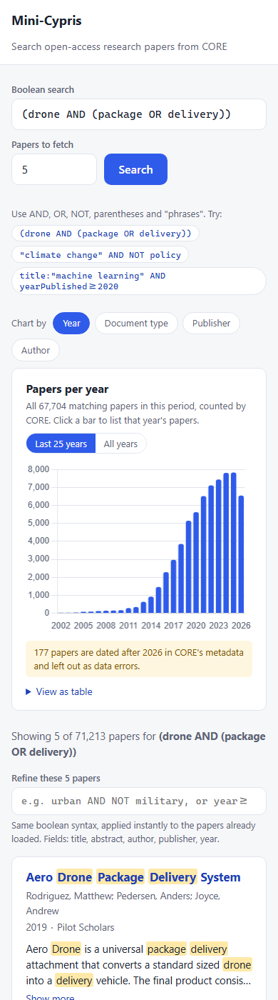

# Mini-Cypris

[](https://github.com/CadeSummers/mini-cypris/actions/workflows/ci.yml)

**Live demo:** <https://mini-cypris.cadetsummers.workers.dev>

A small Angular app for searching open-access research papers through the
[CORE API](https://api.core.ac.uk/docs/v3): boolean keyword search, a control for how many
papers to fetch, and a chart of publications per year across **every** paper that matches the
query.

Built as a take-home project for Cypris. The reasoning behind each choice, with the
alternatives considered, is in [Design_Decisions.md](Design_Decisions.md).


| Year drill-down                                                                                     | Phone width                                                          |
| --------------------------------------------------------------------------------------------------- | -------------------------------------------------------------------- |
|  |  |

## Run it

Requires Node.js 20.19+, 22.12+ or 24+.

```bash
git clone https://github.com/CadeSummers/mini-cypris.git
cd mini-cypris
npm install
npm start
```

Open <http://localhost:4200> and try `(drone AND (package OR delivery))`.

### API key (optional, recommended)

The app works without a key, but CORE then allows only a handful of requests per minute. A
free key raises the daily allowance:

1. Request a key at <https://core.ac.uk/services/api>.
2. Copy `.env.example` to `.env` and paste the key after `CORE_API_KEY=`.
3. Restart `npm start`. The terminal prints whether the key was picked up.

`.env` is git-ignored. The key is read by the dev-server proxy (`proxy.conf.mjs`) and added to
requests on the server side, so it never reaches the browser bundle.

### Other commands

| Command                     | What it does                                                     |
| --------------------------- | ---------------------------------------------------------------- |
| `npm test`                  | Runs the unit tests (Vitest) in watch mode                       |
| `npm test -- --watch=false` | Runs the unit tests once                                         |
| `npm run build`             | Production build into `dist/`                                    |
| `npm run preview`           | Builds, then serves the app and the Worker locally with Wrangler |
| `npm run deploy`            | Builds, then deploys to Cloudflare                               |

`npm start` is the way to develop locally: API calls go through the dev-server proxy, so
opening a static copy of `dist/` directly will not reach CORE.

### Deploying (Cloudflare Workers)

The repository is ready to deploy to [Cloudflare](https://developers.cloudflare.com/workers/):
`wrangler.jsonc` serves the built app as static assets, and `worker/core-proxy.js` plays the
role of the dev proxy, serving `/core-api/*` and adding the key on the server.

```bash
npx wrangler login                     # once; opens the browser
npx wrangler secret put CORE_API_KEY   # paste the key when prompted; stored encrypted
npm run deploy
```

If `secret put` says the Worker does not exist yet, run `npm run deploy` first, then set the
secret. The Worker forwards only the two CORE endpoints the app uses, so the public URL
cannot be used as a general-purpose proxy for the key (see
[Design_Decisions.md](Design_Decisions.md#4-api-key-and-the-dev-proxy)).

## What it does

Mapped to the steps in the project brief:

| Brief | Requirement                         | Where                                                                                          |
| ----- | ----------------------------------- | ---------------------------------------------------------------------------------------------- |
| 1     | Angular 20 or higher                | Angular 21: standalone components, signals, zoneless change detection                          |
| 2     | Query CORE with GET                 | `src/app/core-api/core-api.ts`                                                                 |
| 3     | Clean UI for paper objects          | Paper cards: title, authors, year, publisher, expandable abstract, PDF and DOI links           |
| 4     | Field for how many papers to return | "Papers to fetch" (1–100); changing it re-runs the current search                              |
| 5     | Boolean keyword search              | Main bar queries CORE; "Refine these papers" filters the loaded papers with the same syntax    |
| 6     | Chart aggregating all matches       | Papers per year from CORE's aggregate endpoint, covering every match, not just the loaded page |
| 7     | README and incremental commits      | This file; each commit builds, passes its tests and runs                                       |

## Additions beyond the brief

1. **True aggregate chart.** The chart is computed by CORE over every matching paper (for
   example 71,000 for the drone query), not over the 10 on screen. If that request fails, the
   chart falls back to the loaded papers and says so.
2. **Two kinds of boolean search.** The main bar sends the query to CORE. A second box filters
   the papers already loaded, instantly and without another API call, using a small
   hand-written boolean parser (`AND`, `OR`, `NOT`, parentheses, `"phrases"`, `field:value`,
   `year>=2020`).
3. **Query validation before sending.** Unbalanced parentheses, unclosed quotes and dangling
   operators are caught in the browser with a specific message, and lowercase `and`/`or`/`not`
   gets a hint, since CORE treats those as ordinary words.
4. **Year drill-down.** Click a bar (or a year in the chart's table view) to list only that
   year's papers. The chart keeps showing the whole query so the context is not lost.
5. **Shareable URLs.** The search lives in the URL (`?q=…&limit=…&year=…`), so a search can be
   bookmarked or sent to someone, and back/forward work.
6. **Load more.** Fetches the next page and appends it, skipping duplicates.
7. **Rate-limit awareness.** CORE's limits are tight, so repeated searches are served from an
   in-memory cache, the chart is not refetched when only the page size or year changes, and a
   rate-limit error shows when searching will work again.
8. **Stale-response protection.** Starting a new search cancels the previous request, so a
   slow old response cannot overwrite newer results.
9. **Data cleaning.** CORE aggregates metadata from thousands of repositories. Abstracts are
   stripped of HTML remnants, author names of internal ids, and papers "published" in the
   future are excluded from the chart with a visible note of how many.
10. **Specific states.** Skeleton loading, an empty state with suggestions, and distinct
    messages for rate limiting, bad queries, a rejected key, server errors and being offline.
11. **Accessibility.** Labelled controls, live regions for status changes, a text summary and
    table alternative for the chart, keyboard-reachable year selection, reduced-motion support.
12. **Deployable without leaking the key.** A small Cloudflare Worker stands in for the dev
    proxy, holds the key as an encrypted secret, and is restricted to the two CORE endpoints
    the app needs. It caches successful
    answers at the edge so repeated queries do not spend the shared rate limit.
13. **Tests.** 83 unit tests covering the API service, data cleaning, the boolean parser and
    matcher, the search store (cancellation, caching, paging, fallback) and URL handling.

## Project layout

```
src/app/
  core-api/     CORE client, raw response types, the clean Paper model, error mapping
  search/       search page, search bar, paper card, search store, boolean parser and matcher
  chart/        year chart component and the pure functions that build its data
proxy.conf.mjs  dev-server proxy that adds the API key
worker/         the same proxy as a Cloudflare Worker, for the deployed site
wrangler.jsonc  Cloudflare build output and routing settings
```

## Known limitations

- A deployed copy shares one CORE key, and therefore one rate limit, among all its visitors.
  The Worker caches repeated queries (searches for 10 minutes, year counts for an hour) but
  does no per-user limiting, so a burst of new queries can still be rate-limited.
- The in-browser refine filter matches by substring and only sees the loaded papers; it is a
  convenience on top of CORE's search, not a replacement for it.
- CORE pages by offset only up to 10,000 results; "Load more" stops there.
- The chart component itself is verified by hand in the browser. Its data logic is unit
  tested, but canvas rendering is not.

## A note on AI assistance

This project was built with the help of an AI coding assistant (Claude Code). The design
decisions and trade-offs are documented in [Design_Decisions.md](Design_Decisions.md).
