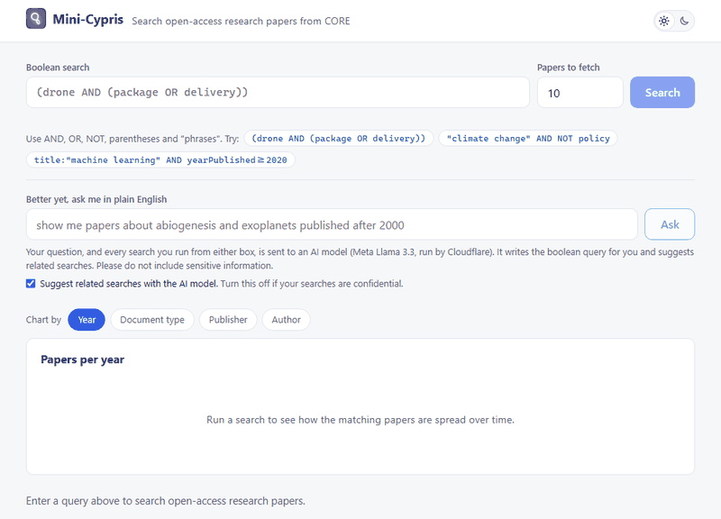
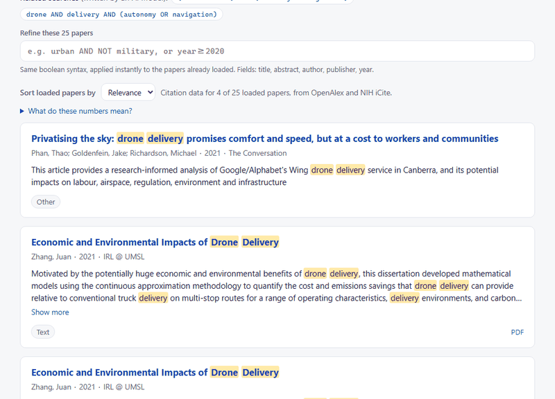
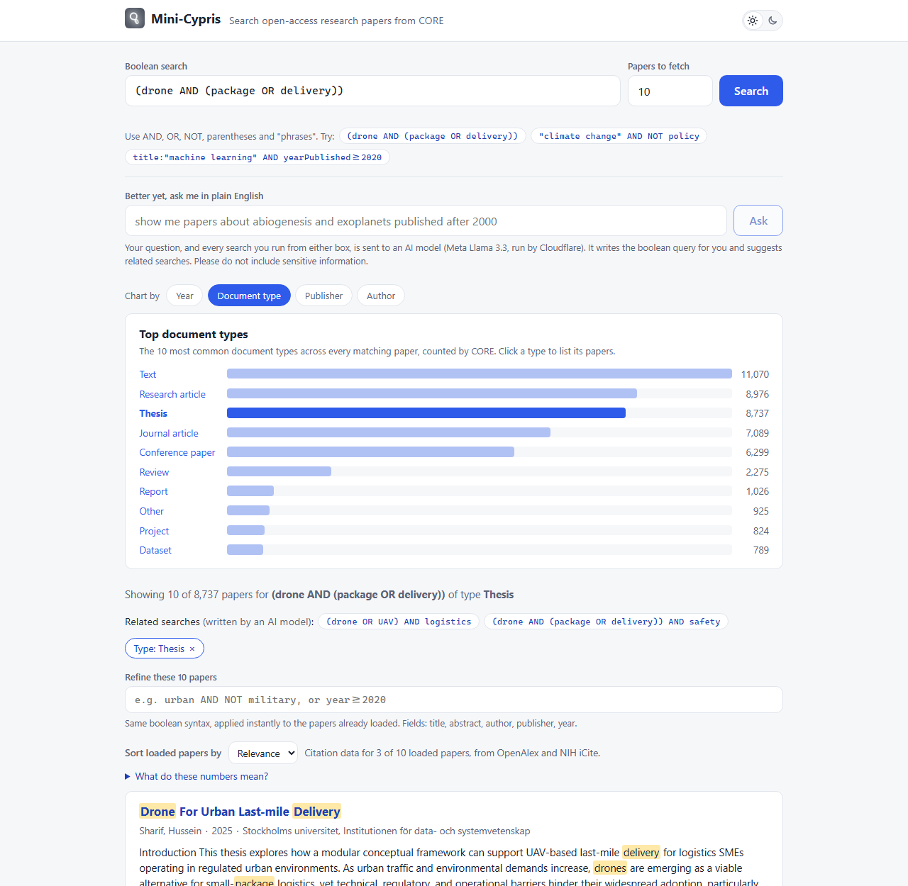

# Mini-Cypris

[](https://github.com/CadeSummers/mini-cypris/actions/workflows/ci.yml)

**Try it: <https://mini-cypris.cadetsummers.workers.dev>** (nothing to install)

An Angular 21 app for searching open-access research papers through the
[CORE API](https://api.core.ac.uk/docs/v3): boolean keyword search, a field for how many papers
to fetch, and a chart counted over every paper that matches the query, not only the ones on
screen. Built as a take-home project for Cypris; it is independent work and is not affiliated
with or endorsed by Cypris.

The live demo shares one free CORE key among all visitors, so it allows a few new searches a
minute. Searches already run are cached and stay instant.


## Running it

The live demo above is the intended way to try the app. To run it from a clone instead, you
need Node.js 22.18+ (or 24+) and a free CORE API key:

```bash
git clone https://github.com/CadeSummers/mini-cypris.git
cd mini-cypris
npm install
cp .env.example .env    # then paste your key after CORE_API_KEY=
npm start               # http://localhost:4200
```

Keys are free at <https://core.ac.uk/services/api>. Without one the app starts, but CORE refuses
most anonymous searches. The key, the test commands and deployment are covered in
[docs/running-locally.md](docs/running-locally.md).

## What the brief asked for

| Step | Requirement                    | Where                                                                                              |
| ---- | ------------------------------ | -------------------------------------------------------------------------------------------------- |
| 1    | Angular 20 or higher           | Angular 21: standalone components, signals, zoneless change detection                              |
| 2    | Query CORE with GET            | `src/app/core-api/core-api.ts`                                                                     |
| 3    | Clean UI for the papers        | Cards with title, authors, year, publisher, expandable abstract, PDF and DOI links                 |
| 4    | Field for how many papers      | "Papers to fetch" (1 to 100); changing it re-runs the search                                       |
| 5    | Boolean keyword search         | The main box searches CORE; "Refine these papers" filters the loaded papers with the same syntax   |
| 6    | Chart over all matching papers | Counted by CORE's aggregate endpoint over every match; by year, document type, publisher or author |
| 7    | README and working commits     | This file; every commit builds and passes its tests                                                |
| 8    | Additions, enumerated          | Summarised below; the full list is in [docs/features.md](docs/features.md)                         |

## Four things worth a look

1. **The chart counts every match.** One request to CORE's aggregate endpoint returns the counts
   by year, document type, publisher and author for the whole result set. Clicking a bar or a
   name lists those papers, selections combine, and they live in the URL. If the aggregate
   request fails, the chart falls back to the loaded papers and says so.
2. **CORE's quirks are measured and repaired.** Sent as the brief writes it,
   `(drone AND (package OR delivery))` came back with 71,213 papers, the same as `drone` alone;
   without the outer parentheses CORE finds 4,729. The app now rewrites every query into a shape
   CORE counts correctly before sending it, and leaves the text you typed alone. It also sends
   author filters to the field CORE really searches, since the documented `authors:` matches
   nothing.
3. **A language model on a short lead.** A question in plain English is turned into a boolean
   query by Meta Llama 3.3 on Cloudflare Workers AI. The Worker checks every answer against the
   query grammar and discards anything else, so no model prose reaches the page, and the query
   is always shown for editing. Related searches can be switched off if your searches are
   confidential; a Boolean search then goes to CORE and nowhere else.
4. **The key never reaches the browser.** A small Cloudflare Worker holds the CORE key as an
   encrypted secret, forwards only the two endpoints and the parameters the app uses, caches
   answers, and counts requests per visitor and for all visitors together.

| Plain-English search                                                                                                 | Citation metrics                                                                                        |
| -------------------------------------------------------------------------------------------------------------------- | ------------------------------------------------------------------------------------------------------- |
|  |  |

| Year drill-down                                           | Document type drill-down                                | Publisher click-through                                                 | Phone width                                             |
| --------------------------------------------------------- | ------------------------------------------------------- | ----------------------------------------------------------------------- | ------------------------------------------------------- |
|  |  |  |  |

## How it is put together

- **One page, one store.** The URL is the source of truth. `SearchStore` turns it into CORE
  requests with RxJS (`switchMap`, so a newer search cancels an older one) and exposes the
  results as signals.
- **One boundary for messy data.** `core-api/paper.ts` turns CORE's records into a clean `Paper`:
  HTML remnants, placeholder authors, repeated papers and future-dated years are handled there.
- **One parser, three uses.** `search/boolean-query.ts` validates the query, drives the
  in-browser refine filter and the highlighting, and is what the CORE rewrite is built on.
- **One Worker.** `worker/` serves `/core-api` (the key and the limits), `/ai` (plain-English
  search and suggestions) and `/metrics` (citation figures from OpenAlex and NIH iCite).

## Tests

Four layers, all run in CI on every push, after a format check and lint: unit tests (Vitest),
end-to-end tests in a real browser against a mocked CORE (Playwright, including accessibility
scans), tests of the Worker in Cloudflare's own runtime (Miniflare), and routing tests of the
production build and the Worker together.

## Known limitations

- The demo shares one CORE key. The Worker caches answers and counts requests, but when several
  people search at once the page will ask them to wait a minute.
- Clicking a publisher with a one-word name can list more papers than its bar counts, because
  CORE matches the word inside longer names. A note under the chart says so.
- Citation metrics exist only for papers with a DOI that OpenAlex knows, which is a minority of
  CORE's records.
- The query rewrite rests on measurements of CORE's behaviour, not on its documentation, and the
  end-to-end tests use a mocked CORE. Neither would notice CORE changing how it reads a query.
- Related searches are on by default, so a search is sent to the model unless the visitor turns
  them off. For customer queries I would make that opt-in.

## Design notes and AI assistance

You can find the reasoning behind each choice, with the alternatives it beat out, in the
[Design_Decisions.md](Design_Decisions.md) file.

This was coded with assistance from Claude Code, and audited by multiple models for accuracy,
performance, and accessibility. Plain English search is handled by Llama and supported by
Cloudflare. Every commit builds and passes the test suites in CI.
