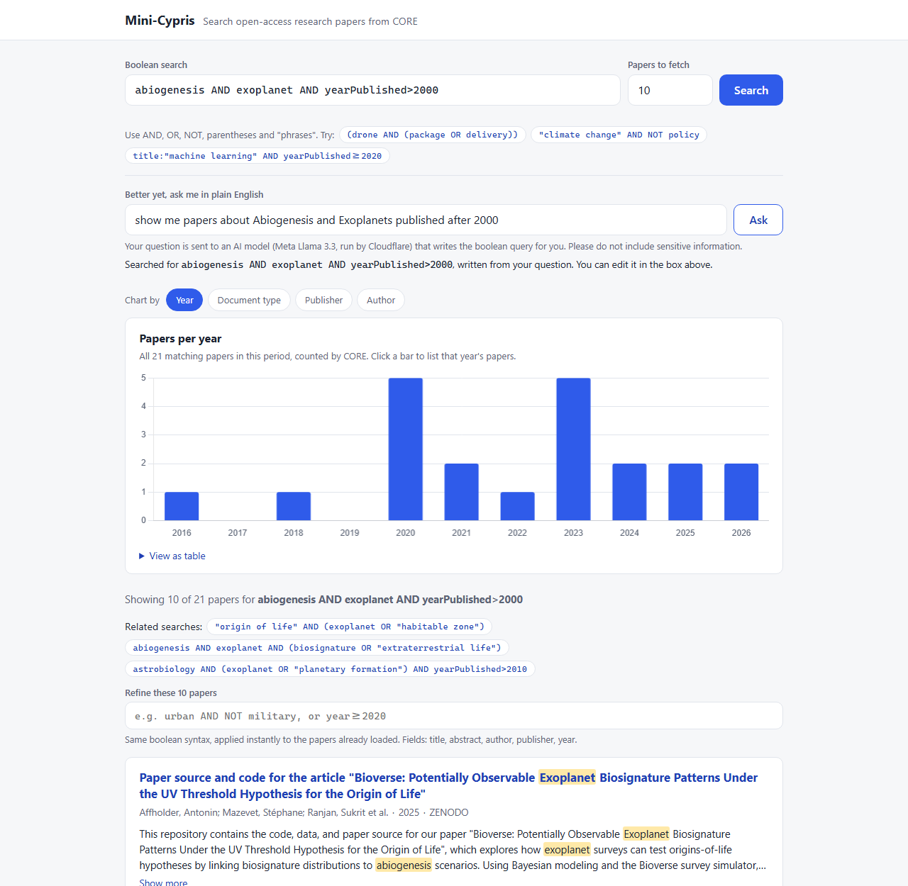
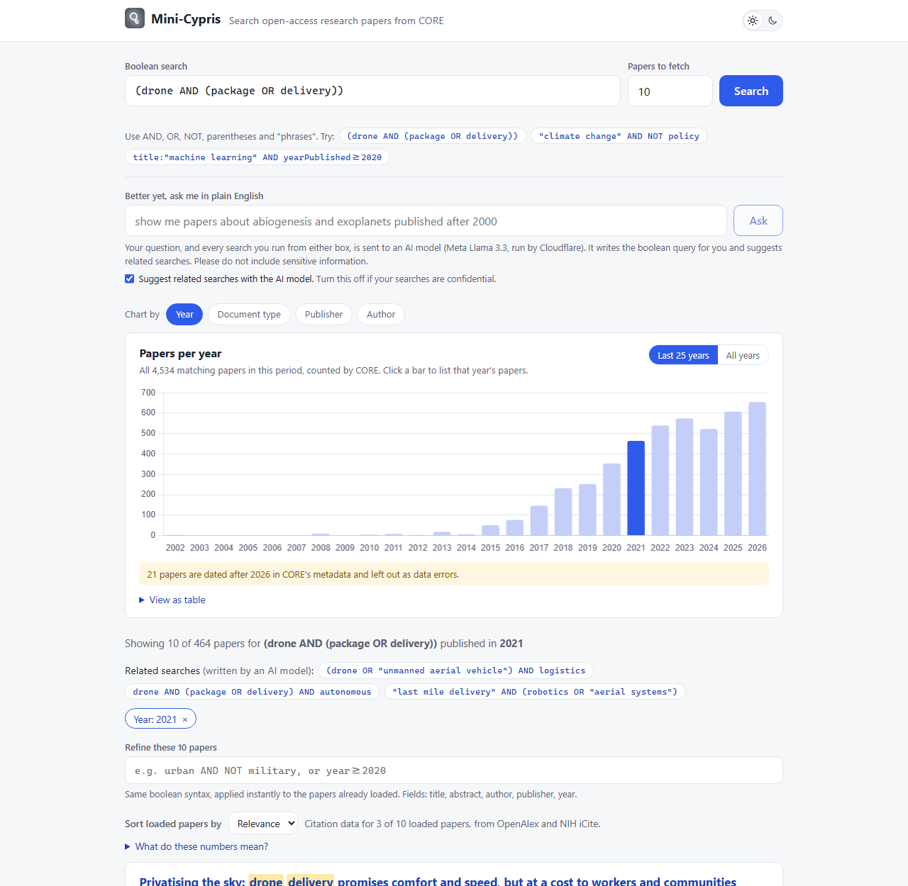

# Mini-Cypris

[](https://github.com/CadeSummers/mini-cypris/actions/workflows/ci.yml)

**Live demo:** <https://mini-cypris.cadetsummers.workers.dev>

A small Angular app for searching open-access research papers through the
[CORE API](https://api.core.ac.uk/docs/v3): boolean keyword search, a control for how many
papers to fetch, and a chart of publications per year across **every** paper that matches the
query.

Built as a take-home project for Cypris. The reasoning behind each choice, with the
alternatives considered, is in [Design_Decisions.md](Design_Decisions.md).




| Year drill-down                                                                                     | Document type drill-down                                                                                                  | Chart by publisher                                                                        | Phone width                                                          |
| --------------------------------------------------------------------------------------------------- | ------------------------------------------------------------------------------------------------------------------------- | ----------------------------------------------------------------------------------------- | -------------------------------------------------------------------- |
|  |  |  |  |

## Run it

Requires Node.js 20.19+, 22.12+ or 24+.

```bash
git clone https://github.com/CadeSummers/mini-cypris.git
cd mini-cypris
npm install
npm start
```

Open <http://localhost:4200> and try `(drone AND (package OR delivery))`.

### API key (optional, recommended)

The app works without a key, but CORE then allows only a handful of requests per minute. A
free key raises the daily allowance:

1. Request a key at <https://core.ac.uk/services/api>.
2. Copy `.env.example` to `.env` and paste the key after `CORE_API_KEY=`.
3. Restart `npm start`. The terminal prints whether the key was picked up.

`.env` is git-ignored. The key is read by the dev-server proxy (`proxy.conf.mjs`) and added to
requests on the server side, so it never reaches the browser bundle.

### Other commands

| Command                     | What it does                                                      |
| --------------------------- | ----------------------------------------------------------------- |
| `npm test`                  | Runs the unit tests (Vitest) in watch mode                        |
| `npm test -- --watch=false` | Runs the unit tests once                                          |
| `npm run e2e`               | Runs the end-to-end tests (Playwright) against a mocked CORE      |
| `npm run test:worker`       | Runs the Cloudflare Worker's tests in a local Workers runtime     |
| `npm run e2e:worker`        | Builds, then tests the app and the Worker together under Wrangler |
| `npm run build`             | Production build into `dist/`                                     |
| `npm run preview`           | Builds, then serves the app and the Worker locally with Wrangler  |
| `npm run deploy`            | Builds, then deploys to Cloudflare                                |

The end-to-end tests need a browser the first time: `npx playwright install chromium`. They
start the dev server themselves and need no API key, because every CORE request is mocked.

`npm start` is the way to develop locally: API calls go through the dev-server proxy, so
opening a static copy of `dist/` directly will not reach CORE.

### Deploying (Cloudflare Workers)

The repository is ready to deploy to [Cloudflare](https://developers.cloudflare.com/workers/):
`wrangler.jsonc` serves the built app as static assets, and `worker/core-proxy.js` plays the
role of the dev proxy, serving `/core-api/*` and adding the key on the server.

```bash
npx wrangler login                     # once; opens the browser
npx wrangler secret put CORE_API_KEY   # paste the key when prompted; stored encrypted
npm run deploy
```

If `secret put` says the Worker does not exist yet, run `npm run deploy` first, then set the
secret. The Worker forwards only the two CORE endpoints the app uses, so the public URL
cannot be used as a general-purpose proxy for the key (see
[Design_Decisions.md](Design_Decisions.md#4-api-key-and-the-dev-proxy)).

## What it does

Mapped to the steps in the project brief:

| Brief | Requirement                         | Where                                                                                                                                                    |
| ----- | ----------------------------------- | -------------------------------------------------------------------------------------------------------------------------------------------------------- |
| 1     | Angular 20 or higher                | Angular 21: standalone components, signals, zoneless change detection                                                                                    |
| 2     | Query CORE with GET                 | `src/app/core-api/core-api.ts`                                                                                                                           |
| 3     | Clean UI for paper objects          | Paper cards: title, authors, year, publisher, expandable abstract, PDF and DOI links                                                                     |
| 4     | Field for how many papers to return | "Papers to fetch" (1–100); changing it re-runs the current search                                                                                        |
| 5     | Boolean keyword search              | Main bar queries CORE; "Refine these papers" filters the loaded papers with the same syntax                                                              |
| 6     | Chart aggregating all matches       | Papers per year from CORE's aggregate endpoint, covering every match, not just the loaded page; switchable to top document types, publishers and authors |
| 7     | README and incremental commits      | This file; each commit builds, passes its tests and runs                                                                                                 |

## Additions beyond the brief

1. **True aggregate chart.** The chart is computed by CORE over every matching paper (for
   example 71,000 for the drone query), not over the 10 on screen. If that request fails, the
   chart falls back to the loaded papers and says so.
2. **Two kinds of boolean search.** The main bar sends the query to CORE. A second box filters
   the papers already loaded, instantly and without another API call, using a small
   hand-written boolean parser (`AND`, `OR`, `NOT`, parentheses, `"phrases"`, `field:value`,
   `year>=2020`).
3. **Query validation before sending.** Unbalanced parentheses, unclosed quotes and dangling
   operators are caught in the browser with a specific message, and lowercase `and`/`or`/`not`
   gets a hint, since CORE treats those as ordinary words.
4. **Year and document type drill-down.** Click a year's bar (or a year in the chart's table
   view), or a type's name in the "Document type" view, to list only those papers. The two
   combine. The chart keeps showing the whole query so the context is not lost.
5. **Shareable URLs.** The search lives in the URL (`?q=…&limit=…&year=…&type=…`), so a search can be
   bookmarked or sent to someone, and back/forward work.
6. **Load more.** Fetches the next page and appends it, skipping duplicates.
7. **Rate-limit awareness.** CORE's limits are tight, so repeated searches are served from an
   in-memory cache, the chart is not refetched when only the page size or year changes, and a
   rate-limit error shows when searching will work again.
8. **Stale-response protection.** Starting a new search cancels the previous request, so a
   slow old response cannot overwrite newer results.
9. **Data cleaning.** CORE aggregates metadata from thousands of repositories. Abstracts are
   stripped of HTML remnants, author names of internal ids, and papers "published" in the
   future are excluded from the chart with a visible note of how many.
10. **Specific states.** Skeleton loading, an empty state with suggestions, and distinct
    messages for rate limiting, bad queries, a rejected key, server errors and being offline.
11. **Accessibility.** Labelled controls, live regions for status changes, a text summary and
    table alternative for the chart, keyboard-reachable year selection, reduced-motion support.
12. **Deployable without leaking the key.** A small Cloudflare Worker stands in for the dev
    proxy, holds the key as an encrypted secret, and is restricted to the two CORE endpoints
    the app needs. It caches successful
    answers at the edge so repeated queries do not spend the shared rate limit. A per-visitor limit (8 new
    CORE requests a minute, counted exactly by a Durable Object) stops one visitor using up
    the allowance everyone shares.
13. **Chart dimension switcher.** "Chart by" Year, Document type, Publisher or Author. All
    four come from one CORE request, so switching is instant and costs nothing against the
    rate limit. Placeholder values are dropped; names CORE spells two ways are left apart and
    the chart says so.
14. **Highlighted matches.** Query words are marked in each title and abstract, for both the
    CORE search and the refine box. Terms under `NOT` are left unmarked, and `title:` terms
    are marked in titles only.
15. **Tests.** 138 unit tests covering the API service, data cleaning, the boolean parser and
    matcher, the search store (cancellation, caching, paging, fallback), chart data and URL
    handling.
16. **End-to-end tests.** 32 Playwright tests drive the app in a real browser against a
    mocked CORE: search, the number of papers, invalid syntax, year and document type drill-down, refine, load
    more, both rate-limit messages, shareable URLs, the chart switcher and its fallback, plus
    two automated accessibility scans. They run in CI on every push.
17. **Worker tests.** 28 tests run the real Worker in Cloudflare's runtime locally (Miniflare)
    against a fake CORE. They check that the key is sent to CORE and never to the browser,
    that only the two allowed endpoints are proxied, that repeated queries come from the
    cache, and that a visitor's 9th new request in a minute is refused.
18. **Routing tests.** 7 browser tests run the production build and the Worker together under
    `wrangler dev`, using the real `wrangler.jsonc`. They check which requests reach the
    Worker and which are served as files, and that the per-visitor limit message appears in
    the page.
19. **Plain-English search.** "Better yet, ask me in plain English": a sentence such as
    "show me papers about abiogenesis and exoplanets published after 2000" is turned into a
    boolean query by a language model (Meta Llama 3.3 70B on Cloudflare Workers AI) and run.
    The query appears in the Boolean box and the URL, so it can be read, edited and shared.
    The model can only produce queries: the Worker checks every answer and discards anything
    else. An American model was chosen deliberately; see `Design_Decisions.md` 7b.
20. **Suggestions.** A search that finds nothing offers "Did you mean" with the spelling
    corrected. "Suggest related searches" offers up to three follow-up queries. Ordinary
    searches send nothing to the model.
21. **Forgiving queries.** CORE answers some harmless queries with a server error (for
    example `"exoplanet"`, a quoted single word). The app repairs those on the way out,
    offers one-click fixes for lowercase operators and wrong field names, and reports a
    rejected query as a query problem instead of an outage.

## Project layout

```
src/app/
  core-api/     CORE client, raw response types, the clean Paper model, error mapping
  search/       search page, search bar, paper card, search store, boolean parser and matcher,
                query fixes, the plain-English box and the suggestions
  ai/           client for the app's own /ai/query endpoint
  chart/        year chart, ranked top-ten chart, the switcher, and the pure functions behind them
proxy.conf.mjs  dev-server proxy that adds the API key (and forwards /ai to the deployed Worker)
worker/         the same proxy as a Cloudflare Worker, the plain-English endpoint, and their tests
wrangler.jsonc  Cloudflare build output and routing settings
e2e/            Playwright end-to-end tests and the mocked CORE they run against
e2e-worker/     browser tests of the built app and the Worker together, and their fake CORE
```

## Known limitations

- A deployed copy shares one CORE key, and therefore one rate limit, among all its visitors.
  The Worker caches repeated queries (searches for 10 minutes, year counts for an hour) and
  limits each visitor to 8 new CORE requests a minute, but several visitors searching at
  once can still reach CORE's own limit.
- Plain-English search and suggestions depend on a free allowance of model calls (about 300
  a day by my estimate). When it runs out they say they are unavailable; the Boolean box is
  unaffected. The model can write a poor query; the query is always shown so it can be
  corrected. Questions are sent to Cloudflare, which does not say in which country the model
  runs. Under `npm start` this one feature calls the deployed Worker.
- The in-browser refine filter matches by substring and only sees the loaded papers; it is a
  convenience on top of CORE's search, not a replacement for it.
- CORE pages by offset only up to 10,000 results; "Load more" stops there.
- Publisher and author bars are not clickable. CORE's filters for those fields do not match
  the charted counts exactly, so a click would list a different number of papers than the
  bar shows.
- The end-to-end tests use a mocked CORE, so they would not notice CORE changing its
  response format. Clicking a bar on the chart canvas is checked by hand; the tests use the
  chart's table view for the same action.
- The Worker's tests run in a local copy of Cloudflare's runtime. Cloudflare's real network,
  the deployed secret and the 60-second limit window actually expiring are checked on the
  deployed site only.

## A note on AI assistance

This project was built with the help of an AI coding assistant (Claude Code). The design
decisions and trade-offs are documented in [Design_Decisions.md](Design_Decisions.md).

Separately, the app itself uses a language model for plain-English search and suggestions
(additions 19 and 20). That model only ever writes search queries.
